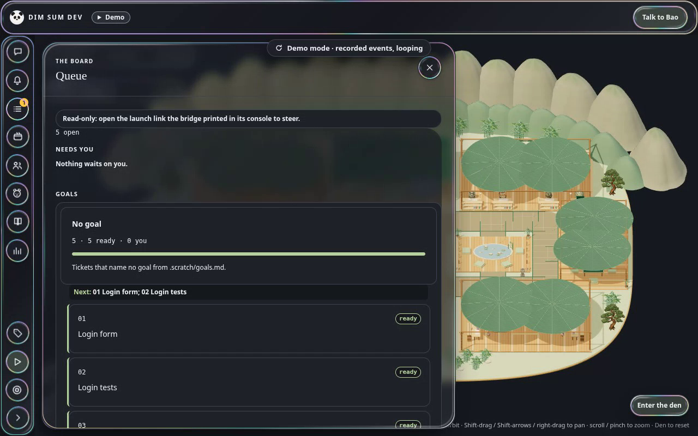
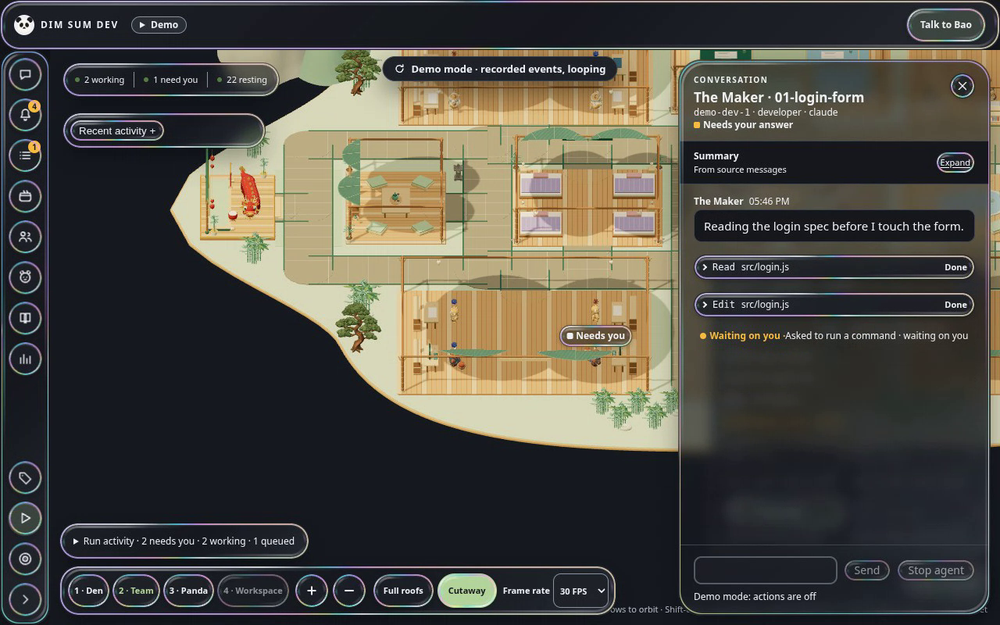
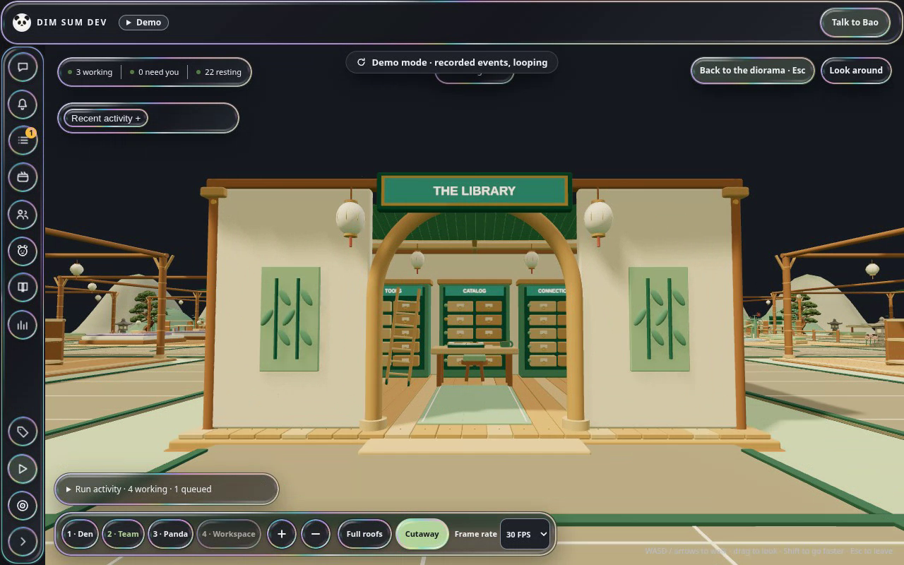
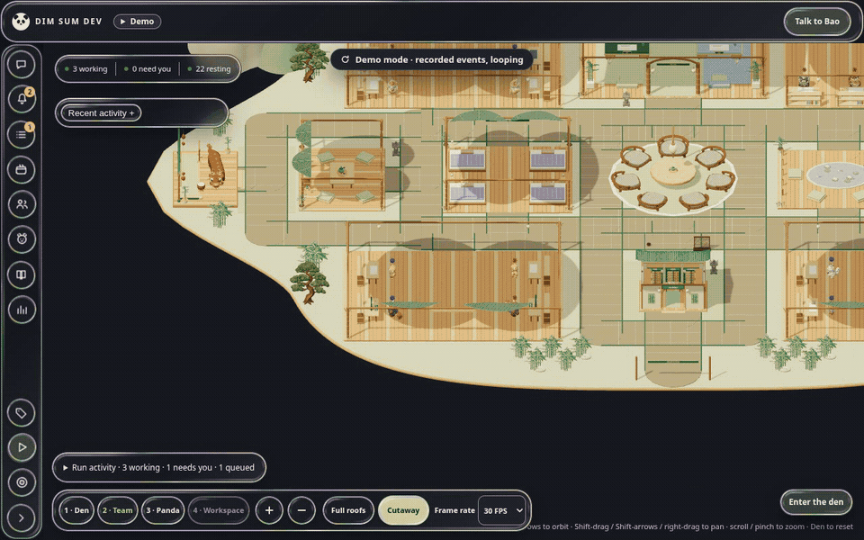
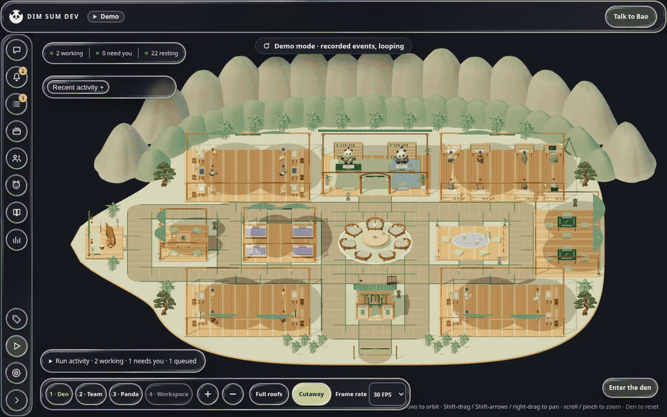

> [!WARNING]
> **Work in progress.** DimSumDev is built for one person's workflow (mine), and the agents in it rebuild it every day.
> Expect breaking changes: keys that move, panels that get redrawn, features that come and go without notice.
> If it's close to what you want, fork it and bend it into what you need.

<div align="center">

# 🥟 DimSumDev

**A local control room where a small team of AI agents builds software, and you sit at the Pass.**

Agents work tickets through a strict relay on a plain-file board, stop at gates only you can open,
and show up as animal residents in a 3D bamboo garden, so you can see who is doing what at a glance.

[](https://github.com/DerekHertz/DimSumDev/actions/workflows/ci.yml)
[](LICENSE)
[](#requirements)
[](https://r3f.docs.pmnd.rs)
[](https://code.claude.com)

[**Run locally**](#run-locally) · [**Controls**](#controls) · [**How it works**](#how-it-works) · [**Numbers**](#numbers) · [**Development**](#development) · [**Glossary**](CONTEXT.md) · [**Decisions**](docs/adr/)

```sh
npm ci && npm run ui    # then open http://127.0.0.1:4317/?demo=den
```

[](docs/videos/dimsumdev-linkedin.mp4)


*Captured from the running app in Demo mode (`?demo=den`). The preview uses the demo's recorded and staged events; steering actions are disabled.*

</div>

---

## What it is

- **A team, not a swarm.** Fourteen roles, each a Claude Code agent running one ticket in its own git worktree. A role is a markdown file in `.claude/agents/` that fixes its model, tools, skills and done criteria. Bao, the orchestrator, sits at the root; Sonnet managers do the work under it; Haiku runners (`runner`, `scout`) do checkable leaf work and start no agent.
- **A kitchen, roughly.** Roles sit at teams named for a dim sum kitchen ([team charter](docs/agents/team-charter.md)):
  - **The Pass** (`orchestrator`, `product`, `architect`, `release-manager`) decides, specs, designs and ships.
  - **Steamers** (`developer`, `scout`, `runner`) build and dig.
  - **Tea & Pantry** (`code-reviewer`, `qa`, `security`, `sre`) review, test, guard and watch the den's health.
  - **Front of House** (`designer`, `technical-writer`, `herald`) keeps things looking right, keeps the docs true and drafts public posts for you to publish.

  `orchestrator`, `herald` and `scout` are retiring into Bao and Jiao (a second executive, on Codex), the technical writer and the runner.
- **Independent review on every code ticket.** The developer writes failing tests and then the change, and never reviews its own work. A code reviewer reads the diff while qa checks the behaviour at the same commit, a risk check decides whether security joins, and the release manager's steps open the PR and merge on green CI ([ADR 0029](docs/adr/0029-team-charter-and-the-task-tree.md)).
- **Gates you can't miss.** Agents stop before adding a dependency, or editing an ADR, `CLAUDE.md` or their own role files, and a change to the bridge, a guardrail or CI is yours to merge. You approve a ticket once; the relay runs end to end and only comes back for a visual verdict, an open scope question, a ticket that failed twice, an environment problem, usage at 90%, or a red merge.
- **A board you can diff.** Tickets are markdown under `.scratch/`, claimed with lock files and handed off through a `board` CLI ([ADR 0003](docs/adr/0003-local-file-board.md), [ADR 0008](docs/adr/0008-board-service.md)). No database, no hosted service.
- **The den.** `apps/ui` is a React Three Fiber garden with four team pavilions around a central meeting plaza, animal residents, and Bao and Jiao as its panda executives ([layout and roster](apps/ui/src/scene/meshy/approved-plan.mjs)). Beside it, your desk holds the queue, what needs you, meetings and the library, with tabs for Work, Pandas and Library and a Talk to Bao button. Zoom from the whole den to a team, a panda or its workspace, or press Enter the den to walk around; walk up to an agent to read its transcript, message it, or approve or deny what it's waiting on.
- **Demo mode.** Open `?demo=den` or press **Watch the demo** to replay a recorded session into the den. It makes no bridge calls and reads no tokens, and every action that would steer a real agent is greyed out.
- **More than one project.** The den works for other repos too, like an agency: `npm run den:project -- add <slug> <path>` onboards one with its own board and queue, and you pick the active project in the den ([ADR 0021](docs/adr/0021-agent-wall-grants-and-the-bridge-as-kernel.md)).
- **Cheap decisions, proved before used.** Small routine choices can go to Jev, a typed-decision model, from the bridge. A use case goes live only after a labelled eval of its real job passes, and every live call logs the rule-based decision beside it for comparison ([ADR 0010](docs/adr/0010-jev-precheck-tier-and-verify-depth.md), Amendment 3).

The garden shows **24 resident identities with permanent desks**: 22 specialists at team desks, plus Bao and Jiao at separate desks in the jade executive pavilion. Each keeps its owned desk while away. The office has independently reserved visitor places for each executive, with a center aisle for meeting travel. Team still lists **32 role and runtime profiles**; this scene change does not retire callable roles or enable Codex dispatch ([placement](apps/ui/src/scene/meshy/approved-plan.mjs), [office ownership and routes](apps/ui/src/scene/meshy/office-56.test.mjs), [inventory and runtime availability](apps/ui/src/shell/resident-inventory.mjs), [roster tests](apps/ui/src/scene/meshy/residents-55.test.mjs)).

Idle specialists may reserve a destination for tea, pond watching, rest, mahjong or a cross-team friend visit. At most three outings run at once, including travel and return. Residents walk at 3.6 scene units/sec and return to work at 4.8, including physical meeting journeys. Local leisure routes are capped at 60 scene units and a planned 20 seconds one way on a clear route; obstructions can delay travel. Settled activities last 45–90 seconds, followed by a 2–4 minute cooldown after returning home. If no safe place is available, the resident stays home. Friends face each other; mahjong uses real paired residents and ends when a partner leaves ([behavior and timing](apps/ui/src/scene/meshy/daily-routines.mjs), [behavior tests](apps/ui/src/scene/meshy/residents-55.test.mjs)).

Work starts immediately during a break. The resident shows **Working · returning to desk**, returns safely and settles at its own desk; a blocked return holds the last safe position. Meetings can use separate guest bodies while busy originals keep working. Closing a meeting sheet does not end its participants' ownership. Reduced motion skips travel animation only over revalidated routes, and hiding the tab pauses ambient scheduling ([work and meeting integration tests](apps/ui/src/scene/meshy/approved-residents.test.mjs), [blocked-return and motion tests](apps/ui/src/scene/meshy/residents-55.test.mjs)).

Bao and Jiao stay at their desks outside meeting ownership and take no ambient leisure outings. Both have independent physical routes to and from the meeting area; Bao uses the existing meeting chair lifecycle and returns to his reserved desk when the meeting ends. Jiao's routes add no meeting authority or Codex dispatch ([office behavior and routes](apps/ui/src/scene/meshy/office-56.test.mjs), [meeting ownership](apps/ui/src/scene/meshy/meeting-residents.mjs), [runtime availability](apps/ui/src/shell/resident-inventory.mjs)).

Floating blue Codex cloud and orange Claude star ornaments follow the resident's runtime. Decorative marks hide behind structures or when crowded; Team also names the runtime in text ([ornaments](apps/ui/src/scene/meshy/runtime-ornaments.mjs), [Team profiles](apps/ui/src/shell/Residents.jsx)).

## Requirements

- Node.js and npm.
- [Claude Code](https://code.claude.com) on your own subscription, to run the agents ([ADR 0001](docs/adr/0001-subscription-cli-cells.md)).
- `git`, and the GitHub CLI (`gh`) for the orchestrator's PRs and CI checks.
- Optional: Playwright's Chromium, for `npm run smoke:ui`.

Linux, macOS and WSL. It's a local tool, and the bridge binds to `127.0.0.1` only.

## Run locally

```sh
git clone https://github.com/DerekHertz/DimSumDev.git
cd DimSumDev
npm ci
npm run ui              # builds the UI, then starts the bridge on port 4317
```

Open <http://127.0.0.1:4317/>. With no agents running, add `?demo=den` to watch a recorded session.

### Run it as a service (Linux and WSL, systemd and bubblewrap)

```sh
npm run den:install     # once: packages, first release, the service; the den then answers on 4317
npm run den:update      # after merging a change to `main`: new release, links switched, service restarted
```

The service runs from release folders under `~/.local/state/den/` (a copy of `main`, its UI built in a sandbox), not from the checkout, so editing the checkout does not change the running den ([ADR 0026](docs/adr/0026-the-den-serves-itself.md)). `den:install` also installs the router (`den-router.service`), a small process beside the bridge that starts approved tickets in the order you set ([ADR 0027](docs/adr/0027-a-router-beside-the-bridge.md)); a change to the router takes effect on the next `den:install`. Both commands print each step and refuse before changing anything on a host without a systemd user manager or bubblewrap. `npm run bridge` is for development: run it with `PORT=4400 npm run bridge`, on another port than the service.

The den's credential proxy ([ADR 0031](docs/adr/0031-container-per-agent.md)) logs in as its own Claude accounts, not as your interactive `claude`: each refresh token is single use, so sharing one login would make the two race, and the den never reads or writes `~/.claude/.credentials.json`. Add an account once per account:

```sh
npm run den:account -- add <name>   # opens claude with CLAUDE_CONFIG_DIR set to ~/.local/state/den/accounts/<name>; type /login, then /exit
npm run den:account -- list         # the accounts, the active one starred
```

The bridge reports the active account and you switch by hand (`POST /accounts/active` with `{ "name": ... }`; the den has no button for it yet); it never switches by itself when an account hits a usage limit. A running den picks a new account up within a minute.

Run an agent as its own Claude Code session:

```sh
claude --agent orchestrator     # plans tickets and runs a relay from the terminal
claude --agent developer        # or any other role in .claude/agents/
npm run next-session            # prints the command to resume from the latest handoff
```

## Controls

| Visit an agent | Enter the den |
| --- | --- |
|  |  |

<details>
<summary>Preview the first-person view</summary>



</details>

| Key | Action |
| --- | --- |
| Enter the den | Enter walk mode (the on-screen W A S D pad works on touch screens) |
| W A S D / arrows | Walk; hold Shift to go faster |
| Mouse drag | Look around; double-click to grab the pointer again |
| Tab | Free the cursor to click a card |
| Esc | Close the transcript, or leave walk mode |
| Click a panda | In the overview, open that panda's card (the one walk mode shows when you stand near it) |
| R | Open the transcript of the agent whose card is showing |
| T | Message that agent, or give a resident panda a task |
| E / Q | Open the permission request that's waiting (that panda's, or the first in Needs you), then allow or deny it |
| J / K | Next or previous request on a card |
| M | Jump to the note field on a card |
| Ctrl/Cmd + Enter | Send the card's action |
| Ctrl/Cmd + K | Focus the input bar |
| 1 Den · 2 Team · 3 Panda · 4 Workspace | Jump the overview camera to a zoom level |
| + / − / wheel / pinch | Zoom the overview camera |
| Arrows / drag | Orbit and tilt the overview camera |
| Shift + arrows / Shift + drag / right-drag | Pan the overview camera |

The **Den** camera button restores the original target, tilt and zoom. First-person walking moves at 5 scene units/sec, or 9 while holding Shift; residents retain their own pacing. Floating exterior panels use subtle frosted glass in the current palette, with solid surfaces when backdrop filtering is unsupported, reduced transparency is requested, or forced colors are active.

Beside the camera controls, **Roof visibility** offers **Full roofs** and **Cutaway**. Full roofs is the first-use default; the choice is saved in this browser, with Full roofs as the fallback when storage is invalid or unavailable. Cutaway retains the rear roof section and frame to reveal interiors ([controls](apps/ui/src/App.jsx), [preference and tests](apps/ui/src/scene/meshy/residents-55.test.mjs), [roof construction](apps/ui/src/scene/meshy/approved/approved-structures.mjs)).

In **Team**, selecting a resident opens its profile with role, runtime, real work state and any scene note. Use the keyboard-operable **Talk**, **View work** and active-tool inspection buttons; unavailable actions show a reason. Codex Talk/tasks remain disabled until runtime support is enabled ([Team actions](apps/ui/src/shell/Residents.jsx), [runtime availability](apps/ui/src/shell/resident-inventory.mjs)).

## How it works

```
                                                         ┌─▶ code-reviewer ─┐
 you ── approve ticket ──▶ router / Deliver ──▶ developer ┤                  ├─▶ risk-check ──▶ PR ──▶ merge on green
                                │                        └─▶ qa verify ─────┘   (security on a hit)
                                │                                                         │
                                └──── board (.scratch/, locks, handoffs) ◀────────────────┘
                                                      │
                                      bridge (127.0.0.1:4317, /state, /events) ──▶ den UI
```

The relay is sized to risk: a ticket on a risk path (the wall, CI, hooks, the service, auth, dependencies) has qa write failing tests before the developer starts, and its verify is light; anything else goes straight to the developer and gets a full verify. One fix round carries both reviews' findings.

- **Bridge.** `apps/bridge` reads the board, streams changes over server-sent events at `/events`, and serves `/state` and `/metrics` ([ADR 0011](docs/adr/0011-ui-v0-seams-bridge-snapshot-scene.md)). What you do in the den (approvals, messages) goes back as requests that the orchestrator acts on.
- **Mechanical checks.** The rules agents skip most are enforced by scripts, not by asking nicely: `npm run risk-check`, `npm run check:bom`, `npm run session-check`, and a release gate that won't let an agent drop a ticket without a handoff ([ADR 0009](docs/adr/0009-mechanical-checks-for-most-skipped-rules.md)).
- **Spend you can see.** Every agent run is logged to `.scratch/usage.jsonl` with its model, tokens and time. `npm run spend` totals them per ticket and per role.

- **Agents from the den.** Press T beside a resident panda that has no agent and type a task. The bridge writes a ticket under `.scratch/den/` and starts that role's Claude Code agent in its own git worktree. Its tool calls, permission requests, final reply and cost show on the panda's card, and you can message it while it works. A permission request also shows in the Needs you card and in the transcript, with Deny and Allow ([ADR 0016](docs/adr/0016-ui-steering-channel.md)).

  

  *Demo mode in the running app, moving from the global view to a developer's card and conversation, then taking a first-person tour past the tea garden, Bao's courtyard and Steamers. The scout's events are from a recorded run; the developer and qa storylines are staged. Steering actions are disabled. [Download the MP4 with captions and an original soundtrack](docs/videos/dimsumdev-linkedin.mp4).*

- **The router.** The router follows the bridge's `/events` and starts deliveries for `ready-for-agent` tickets from the top of a work order file, two at a time when their files don't overlap. It looks again every few minutes at a delivery paused on your merge (`guardrail`) or on checks (`ci-pending`): once you have merged the pull request on GitHub the ticket resolves with no click, and the router never merges a change that is yours to merge. It also resolves an `in-review` ticket whose branch was merged outside a delivery. It starts nothing at 90% usage, and sends every stop to Needs you and to your phone ([ADR 0027](docs/adr/0027-a-router-beside-the-bridge.md)).
- **Delivery from the den.** Deliver on a ticket runs the developer, the code reviewer and qa's verify, the scripted checks and, on a hit, security; then the bridge pushes, opens the PR and merges on green checks ([ADR 0024](docs/adr/0024-delivery-jobs.md)). A change to the bridge, a guardrail or CI is left for you to merge.
- **Meetings.** Ask up to six specialists for one take each; Bao then writes a decision brief with two or three options, and choosing one writes a ticket for your approval ([ADR 0017](docs/adr/0017-meetings-and-decision-briefs.md)).

In progress: Codex as a second runtime, with Jiao as a second executive beside Bao, and task trees in place of the fixed relay ([ADR 0004](docs/adr/0004-runtime-adapter.md), [ADR 0029](docs/adr/0029-team-charter-and-the-task-tree.md)). The bridge already records each run's runtime; agents still run on Claude Code only.

## Numbers

All of these can be re-run, as of `20a854a`.

- **1,582 commits on `main`**, 328 of them merges: `git log --oneline 20a854a | wc -l`, then add `--merges`.
- **418 test files**: `find apps packages scripts mods -name "*.test.mjs" -not -path "*/node_modules/*" | wc -l`.
- **29 recorded decisions** in [`docs/adr/`](docs/adr/).
- **850 logged agent runs across 180 tickets, about 170.3 million tokens**: the `kind:"agent"` rows (`kind:"cell"` before ADR 0028) of `.scratch/usage.jsonl`, summing `tokens` (17 early rows carry no token count).

## Development

```sh
npm test                # node:test across apps, packages and scripts (runs check:bom first)
npm run ui:dev          # Vite dev server for the UI alone
npm run bridge          # the bridge alone (development; the service is `den:install`)
npm run smoke           # HTTP smoke check
npm run smoke:ui        # browser smoke check (Playwright + Chromium)
npm run risk-check      # decides whether a branch needs a security review
npm run board -- status <feature>/<NN-slug>
```

Layout: `apps/ui` (React + React Three Fiber, built by Vite, the only build step), `apps/bridge` (localhost server), `apps/router` (the router), `apps/board` (the board CLI), `apps/ci-cd` (dev server and smoke checks), `packages/` (shared libraries), `mods/` (Claude Code mods), `scripts/` (relay tooling). Everything else is Node ESM run with `node --test`.

### Refresh the README media

With the existing Playwright Chromium and `ffmpeg` / `ffprobe` installed:

```sh
PW_GPU=1 DISPLAY=:0 node scripts/capture-readme.mjs   # WSL GPU; omit these variables for headless capture
node scripts/render-readme-media.mjs
```

The capture runs an isolated Vite server with local responses for bridge reads. It uses the demo fixture, opens a panda's conversation, and walks through the garden without launching agents. Screenshots and GIFs go to `docs/images/`; the 18-second, 1920 × 1080 H.264/AAC video goes to `docs/videos/dimsumdev-linkedin.mp4`. Temporary footage stays under the system temp directory. The video includes captions for muted playback and an original synthesized soundtrack.

### Claude Code settings

Once you trust this folder in Claude Code, `.claude/settings.json` runs repo scripts as hooks: `scripts/session-start.mjs` on start, `scripts/hooks/context-budget.mjs` before each tool call, and `scripts/notify.mjs` on notifications and stop, plus `scripts/statusline.mjs` for the status line. To show plan usage, `scripts/usage-claude.mjs` reads your Claude Code login (`~/.claude/.credentials.json`, or the macOS Keychain) and sends it only to `api.anthropic.com`. The shared allow list holds read-only commands; put push and PR permissions in your own `.claude/settings.local.json`. Read changes to `scripts/` and `.claude/` in an outside pull request before you open its branch in Claude Code.

The board (`.scratch/`) is not part of this repo; without one, the board is simply empty.

## More

- [`CONTEXT.md`](CONTEXT.md): the glossary (org, team, agent, role definition, Bao, perch and the rest).
- [`docs/adr/`](docs/adr/): every recorded decision and why it was made.
- [`docs/agents/`](docs/agents/): how agents use the board, worktrees and process hygiene.

## License

[MIT](LICENSE)
